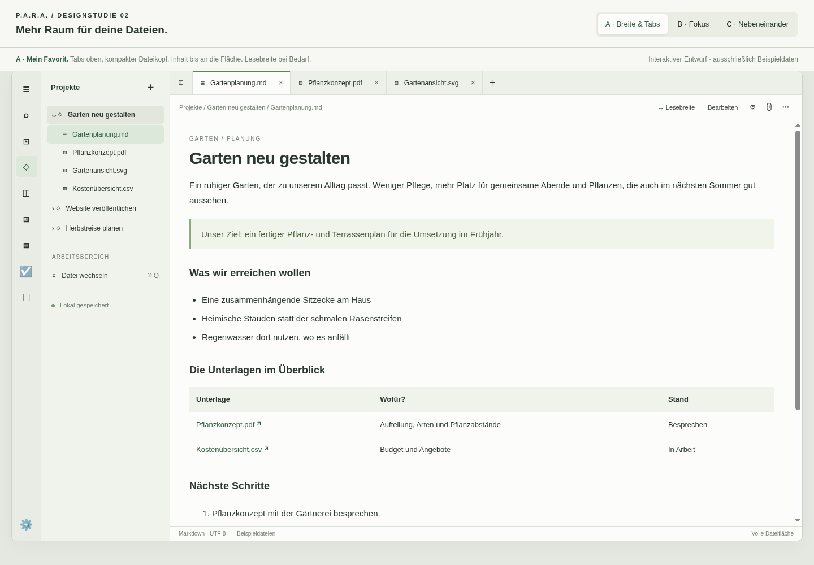

# Dateifläche und Tabs – Designstudie

Stand: 26. Oktober 2026. Ausgewählt ist **A mit optionalem B** sowie einer zusätzlich
per Ziehen verstellbaren Explorer-Breite. **C ist auf später zurückgestellt.**
Der [Umsetzungsstand](../DATEI_TABS_UMSETZUNGSPLAN.md) beschreibt die App-Version 0.9.0
mit A, B und verstellbarer Explorer-Breite. Die Mocks bleiben ein Variantenvergleich.
Der vorhandene HTML-Entwurf demonstriert noch keine ziehbare Explorer-Kante.

Den [interaktiven Entwurf](para-datei-tabs.html) lokal im Browser öffnen. Er braucht
keinen Server, keine Downloads und keinen Zugriff auf den Arbeitsbereich.
Oben A, B oder C wählen; im Explorer vier Dateiformate ausprobieren.

## Varianten

| Variante | Gestaltung | Konsequenz |
| --- | --- | --- |
| A · Breite & Tabs | Bestehende Symbolleiste und Explorer, Dateitabs, kompakter Dateikopf, breite Inhaltsfläche | Empfehlung als Ausgangspunkt. Weniger Außenränder; lange Textzeilen bei großen Fenstern. Lesebreite optional zuschalten. |
| B · Fokus | Gleiche Dateitabs, Explorer ausgeblendet; Navigation per Button zurückholen | Mehr Platz für PDF, Bilder und Tabellen. Ordnerwechsel braucht einen zusätzlichen Klick. |
| C · Nebeneinander | PDF links und Markdown rechts, unabhängig scrollbar | Beim Lesen direkt Notizen machen. Zwei Dateien brauchen genügend Fensterbreite. Im schmalen Entwurf untereinander. |

[A als PDF-Ansicht](para-datei-tabs-a-pdf.png) ·
[B: Fokus mit PDF](para-datei-tabs-b.png) ·
[C: PDF neben Notiz](para-datei-tabs-c.png)

## Gestaltungsideen

- Die gemeinsame Kopfzone besteht aus Dateitabs und einer schmalen Pfad-/Aktionszeile.
  Keine zusätzliche große Dateikarte; Titel im Dokument, Dateiinfos auf Abruf.
- In der umgesetzten App nutzen Vorschauen die verfügbare Breite und Höhe.
  Markdown kann wahlweise eine begrenzte Lesebreite nutzen. PDF hat keine feste
  520-Pixel-Vorschau mehr; Bilder bleiben proportional, CSV scrollt bei Bedarf horizontal.
- Ein Klick im Explorer öffnet eine temporäre Vorschau als kursiven Tab. Eine
  weitere neue Datei ersetzt diesen Vorschautab. Doppelklick behält ihn dauerhaft.
  Bereits offene Dateien werden ausgewählt, ohne doppelte Tabs anzulegen.
- Suche/Dateiwechsel bleiben auf Abruf. Plus neben den Tabs öffnet hier den
  Dateiwechsel; Neuanlage bleibt beim Explorer. Cmd/Ctrl+O öffnet den Dateiwechsel.
- Explizites Speichern bleibt erhalten. Ein Punkt kennzeichnet geänderten Text.
  Wechseln, Tab schließen oder Variante wechseln fragt bei Änderungen nach
  Speichern, Verwerfen oder Abbrechen. Kein Beschluss zu Autosave oder Live Preview.
- Verlauf und Dateiinfo bleiben kleine Buttons. Papierkorb bleibt links unter Aufgaben.

## Grenzen und offene Entscheidungen

- Alle Inhalte sind synthetisch. PDF ist eine gestaltete HTML-Seite, keine echte
  PDF-Engine; der Gartenplan ist inline SVG. Keine Dateien werden gelesen/geschrieben.
- Bearbeiten demonstriert Quelltext und Speicherschutz. Nach einem Speichern wird
  der geänderte Text schlicht angezeigt; kein vollständiger Markdown-Renderer.
  Entwürfe bestehen nur während der geöffneten Seite, ohne dauerhafte Speicherung.
- Split zeigt ein festes Beispielpaar. Freie Aufteilung, Größenänderung,
  tabbezogene Split-Zuordnung und Drag-and-drop sind nicht implementiert.
- Der Umsetzungsplan konkretisiert Vorschautabs, gemeinsame Tabs über Projekte,
  viele offene Dateien, Sitzungsübernahme und Schutz beim Rootwechsel. Mehrere
  unabhängige ungespeicherte Editoren sind für später zurückgestellt.
- Dateispezifische Aktionen, echter Verlauf, globale Navigation und externe Apps
  sind nur Platzhalter. Der letzte Tab bleibt für den Vergleich als Beispieldatei offen.

## Prüfung

Im lokalen Headless-Chromium mit 1440 × 1000 und 390 × 844 geprüft:
breite Markdown-Fläche, optionale 760-Pixel-Lesebreite, hohe PDF-Fläche,
Fokusnavigation, zwei getrennte Scrollflächen, Tabwechsel/-schließen,
temporärer Vorschautab, CSV, Dateiwechsel sowie Speichern/Abbrechen beim
Dateiwechsel. Kein horizontaler Seitenüberlauf am schmalen Fenster;
Split dort untereinander, keine JavaScript-Ausnahmen. Vier Desktop-Vorschaubilder
erzeugt, A und C visuell geprüft. Das ist keine Abnahme nativer App-Funktionen.
